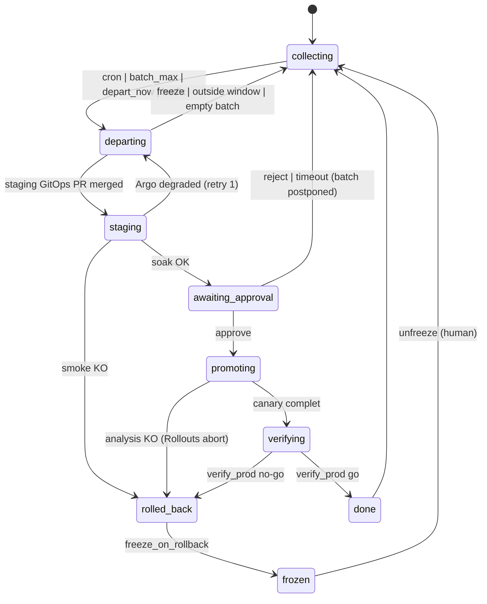
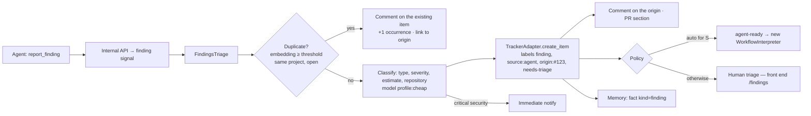

# 5. Release train and findings

## 5.1 Release train — why three locks

| Lock | What it guarantees | Where |
| :-- | :-- | :-- |
| Merge queue | `main` always integrated and green, one PR at a time | GitHub / GitLab |
| `ReleaseTrain` (Temporal, singleton per project × env) | A single deployment in progress per environment, batches, cadence, windows, soak, approval, canary, rollback, freeze | Choregos |
| Declarative guardrails | Even if Choregos goes down, nobody deploys outside the rules: Argo CD *sync windows*, `GitHub Environment production` (required approvers, wait timer), Atlantis lock for Terraform | Cluster / SCM |

## 5.2 `ReleaseTrain` — specification

```yaml
# excerpt from .choregos/policy.yaml
release_train:
  dev:     { mode: auto_sync }                                  # no train: Argo follows main
  staging: { schedule: "*/30 9-19 * * 1-5", batch_max: 10, soak_minutes: 10, approval: none }
  prod:
    schedule: "0 10,14,17 * * 1-4"                              # Europe/Paris
    windows: ["Mon-Thu 09:00-18:00"]
    batch_min: 1
    batch_max: 8
    soak_minutes: 20
    approval: { group: release-captains, required: true, timeout_hours: 4 }
    canary: { steps: [10, 50, 100], analysis: slo-default, step_minutes: [10, 15, 0] }
    express_lane: { label: hotfix, soak_minutes: 5, skip_schedule: true, approval: { group: release-captains } }
    freeze: false
    auto_rollback: true
    freeze_on_rollback: true
    terraform: { via: atlantis, apply_requires_approval: true }
```



Signals: `merged(work_item, sha, risk, labels)`, `depart_now(by)`, `freeze(reason, by)`, `unfreeze(by)`, `approve(release_id, by)`, `reject(release_id, by, reason)`, `abort(by)`, `deploy_event(InboundEvent)`. Query: `status()` (batch, next departure, lock, freeze).

Activities: `check_window`, `create_release`, `promote(env, changes)` (`CdAdapter.promote` → GitOps PR, merged automatically or by an approver depending on the env), `wait_synced`, `run_smoke` (Tekton Job `smoke-<env>`), `soak(minutes, slo_query)` (Prometheus/Azure Monitor), `request_approval` (Slack + GitHub Environment + front end), `promote_canary_step`, `analysis_status`, `abort_rollout`, `write_release_notes` (stage `release_notes`), `notify`, `mark_items(deployed|rolled_back)`, `record_incident` (`critical` finding + memory).

Terraform: a project's infra changes are ordinary PRs on its `infra/` repository; Atlantis posts the `plan`; the `apply` is triggered by the train **during a departure**, after approval, under the Atlantis lock. Choregos holds no cloud credential: Atlantis has them.

Feature flags: `refine` requires a flag (OpenFeature + Unleash) for `risk: high`; the `flag_present` gate checks that a flag named in the spec exists in the code; activation remains a product decision outside the train.

## 5.3 GitOps — layout of the environments repo

```
<project>-gitops/
├── apps/<app>/base/                 (kustomize: Deployment→Rollout, Service, HPA, PDB)
├── apps/<app>/overlays/{dev,staging,prod}/  (images, replicas, AnalysisTemplate refs)
├── releases/<env>/manifest.yaml     (written by the train: release id, items, SHAs, images)
└── argocd/                          (Applications, sync windows, notifications)
```

The train modifies only `apps/*/overlays/<env>/kustomization.yaml` (image tags) and `releases/<env>/manifest.yaml`, in a PR titled `release(<env>): R-2026.09.18-2` whose body is the batch log (tickets, PRs, risks, notes). `AnalysisTemplate slo-default`: 5xx rate < 1%, p95 latency < threshold, business errors < threshold, on the project's Prometheus queries (configurable).

## 5.4 Findings — pipeline



Rules: cap per run; dedup threshold `policy.findings.dedupe_threshold` (default 0.86, `platform/embed` embeddings); a finding of `critical` severity **within scope** is fixed in the current PR and reported; out of scope, never fixed — ACP permission refused + diff check + `scope_respected` gate. Ticket template: origin (ticket, PR, run, transcript), type, severity, estimate, `file:line` evidence, impact, suggested fix, why out of scope. The created finding is an ordinary `WorkItem`; its cost is accounted on it, not on the origin.

Quality loop: the front end shows per project the ratio of findings created / findings closed as "relevant"; a false-positive rate > 30% over 30 days triggers a review of the `implement` prompt (invariant "only report what is actionable").
