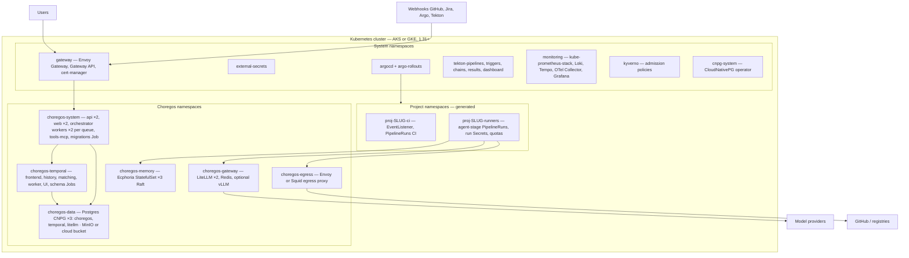

# 6. Deploying the platform on Kubernetes

Choregos is deployed **on** Kubernetes and deploys **to** Kubernetes; the two planes are separate: the platform lives in its `choregos-*` namespaces, each customer project in `proj-<slug>-*`. Everything is GitOps: the `VargaFoundation/choregos-infra` repository is the cluster's only source of truth; nobody (neither human nor API) applies a manifest by hand.

## 6.1 Topology



Node pools:

| Pool | Size | Role | Notes |
| :-- | :-- | :-- | :-- |
| `system` | 3 × 4 vCPU / 16 GB | System components, API, Temporal, Postgres | `role=system` taints; SSD storage |
| `platform` | 2–3 × 8 vCPU / 32 GB | LiteLLM, Ecphoria, Tekton controllers, monitoring | |
| `runners` | 0–20 × 8 vCPU / 32 GB **spot/preemptible** | Agent and CI PipelineRuns | Cluster autoscaler; `RuntimeClass gvisor` installed; `role=runners` taint; eviction tolerated (the run replays) |
| `gpu` (optional) | 0–2 | Local vLLM | Only with a local model |

## 6.2 Components and charts

Umbrella `charts/choregos/Chart.yaml` :

```yaml
apiVersion: v2
name: choregos
version: 1.0.0
dependencies:
  - { name: choregos-api,          version: 1.x, repository: file://charts/api }
  - { name: choregos-web,          version: 1.x, repository: file://charts/web }
  - { name: choregos-orchestrator, version: 1.x, repository: file://charts/orchestrator }
  - { name: choregos-tools,        version: 1.x, repository: file://charts/tools }
  - { name: temporal,              version: ~0.6x, repository: https://go.temporal.io/helm-charts, condition: temporal.enabled }
  - { name: litellm,               version: pinned, repository: oci://ghcr.io/berriai/litellm-helm, condition: gateway.enabled }
  - { name: ecphoria,              version: 1.x, repository: oci://ghcr.io/vargafoundation/charts, condition: memory.enabled }
  - { name: redis,                 version: pinned, repository: oci://registry-1.docker.io/bitnamicharts }
```

The operators and cluster tooling (CNPG, cert-manager, ESO, Envoy Gateway, Argo CD, Rollouts, Tekton via `tektoncd/operator`, kube-prometheus-stack, Loki, Tempo, OTel Collector, Kyverno, gVisor `containerd-shim` via DaemonSet) are installed by `choregos-infra/bootstrap/` (app-of-apps), not by the umbrella.

Choregos sub-charts — notable points:

| Chart | Content |
| :-- | :-- |
| `api` | Deployment ×2, HPA (CPU 70%), PDB, `Service`, `HTTPRoute`, `ServiceAccount` (rights: read `PipelineRun` status in `proj-*`, nothing else), `ConfigMap` (OIDC, URLs), `ExternalSecret` (DB, JWT keys, webhook secrets, GitHub App key), pre-install/pre-upgrade `Job` `python -m choregos_api.migrer` (core + extension branches) (Helm `pre-upgrade` hook, `wait`) |
| `web` | Deployment ×2, `HTTPRoute`, strict CSP, `NEXT_PUBLIC_*` |
| `orchestrator` | One Deployment per task queue (`orchestrator`, `executor`, `tracker`, `memory`), 2 replicas, `ServiceAccount executor` with RBAC: create/list/delete `PipelineRun`, `Secret`, `ConfigMap` in the `proj-*-runners` namespaces only (one Role per namespace generated by the provisioning); optional KEDA (scale on `temporal_task_queue_backlog`) |
| `tools` | Publishes the `choregos-tools` image and the `choregos-agent-stage` Tekton `Task` as `ClusterTask`-like (Task in each project namespace via Kustomize) |
| `temporal` | Postgres persistence (CNPG `temporal`), `numHistoryShards: 512`, frontend/history/matching/worker ×2, UI behind OIDC, `schema` Jobs |
| `litellm` | `litellm` Postgres, Redis, `proxy_config` from a `ConfigMap` + models in the database, `PodDisruptionBudget`, `NetworkPolicy` (ingress: runners, orchestrator, api; egress: providers via the egress proxy) |
| `ecphoria` | StatefulSet ×3, 50 GB SSD PVC, Raft, `CronJob` backup to a bucket, `ServiceMonitor` |

## 6.3 `choregos-infra` — GitOps of the platform

```
choregos-infra/
├── bootstrap/                      # Argo CD app-of-apps: operators and tooling (sync-wave 0–2)
│   ├── cert-manager/ external-secrets/ envoy-gateway/ cnpg/ tekton-operator/ argo-rollouts/ kyverno/ monitoring/ gvisor/
├── platform/                       # the choregos umbrella per environment (sync-wave 3)
│   ├── base/ (Application → charts/choregos)  overlays/{dev,staging,prod}/values.yaml
├── projects/                       # written by ProjectProvisioning; "git directory generator" ApplicationSet (sync-wave 4)
│   └── <slug>/  namespaces.yaml  quotas.yaml  netpol.yaml  rbac.yaml  tekton/ (EventListener, Pipeline CI, Task agent-stage)  argocd/ (Applications dev/staging/prod)
└── policies/                       # Kyverno: signed images, non-root, no latest, mandatory labels, quotas present
```

Synchronisation order by `sync-wave`; `projects` `ApplicationSet` with `prune: true` and `selfHeal: true`. The Argo CD bot has write rights; the Choregos API only has the right to **commit** into `projects/` (dedicated GitHub App, repository scope).

## 6.4 Environments

| Env | Target | Specifics |
| :-- | :-- | :-- |
| `dev` | kind (3 nodes) or k3d, `make dev-up` (Tilt) | Temporal dev-server, single Postgres, LiteLLM with a test provider (`fake-openai` + one real cheap model), single Ecphoria, complete Tekton, light Argo CD, local Keycloak, fixtures |
| `staging` | Shared cluster, `stg-` namespace prefix, or dedicated cluster | Synthetic data, reference projects for the evals, automatic promotion from `main` |
| `prod` | Dedicated cluster (AKS `eu-west` or GKE `europe-west1`) | HA (section 6.5), backups, deployment windows, **the platform is deployed by its own release train** (dogfooding from phase 4) |

Promotion of the platform: image tagged by SHA → `platform/overlays/staging` (auto) → soak → `platform/overlays/prod` PR (release captain approval) → Argo Rollouts canary on `api`/`web`/`orchestrator` (the Temporal workers support rolling thanks to workflow versioning: `workflow.patched()` for any logic change).

## 6.5 High availability and data

| Component | HA | Backup | Prod RPO / RTO |
| :-- | :-- | :-- | :-- |
| Postgres (3 CNPG clusters) | 3 instances, automatic failover, PgBouncer | Base + continuous WAL to a bucket (Barman), 30 d retention, automated monthly restore test | 5 min / 30 min |
| Temporal | 2 replicas per service, `numHistoryShards` fixed from the start (cannot be changed) | via Postgres | same |
| Ecphoria | Raft 3 nodes, PDB `minAvailable: 2` | daily `CronJob` + integrity manifest (E-11) | 24 h / 1 h |
| LiteLLM | 2 replicas, Redis | via `litellm` Postgres (spend logs) | 1 h / 15 min |
| Object store (transcripts, reports, context packs) | Versioned cloud bucket (Blob/GCS) or distributed MinIO | Versioning + 180 d lifecycle | — |
| Tekton Results | Shared `choregos` Postgres (dedicated schema) | same as Postgres | — |

Runbooks (`docs/runbooks/`): Postgres restore, loss of an Ecphoria Raft node, GitHub App secret rotation, LiteLLM `master_key` rotation, Temporal version upgrade, run purge, "frozen train" incident.

## 6.6 Secrets, identity, network

- **Secrets**: External Secrets Operator ↔ Azure Key Vault / GCP Secret Manager (Vault possible). No secret in Git; bootstrap by a single `ClusterSecretStore` created by hand. Rotation: GitHub App key (90 d), LiteLLM `master_key` (90 d), the API's ES256 JWT keys (30 d, two-key rotation), webhook secrets (180 d).
- **Identity**: OIDC for humans (front end, Argo UI, Temporal UI, Grafana); workload identity (Azure AD Workload Identity / GKE Workload Identity) for the components that talk to the cloud (ESO, backups, Atlantis); **none** for the runners.
- **Ingress**: Gateway API (Envoy Gateway) + cert-manager (Let's Encrypt DNS-01); `api.<domain>`, `app.<domain>`, `hooks.<domain>` (webhooks, dedicated rate limit), `temporal.<domain>`, `argocd.<domain>`, `grafana.<domain>` behind OIDC.
- **Egress**: egress denied by default in `proj-*-runners` and `choregos-gateway`; egress proxy with a per-project allowlist (`policy.network.allow_domains`), logging, credential injection for private registries; the model providers are reachable only from `choregos-gateway`.
- **Admission** (Kyverno): signed images (cosign, the foundation's keys) and by digest; `runAsNonRoot`; no `hostPath`/`privileged`; `choregos/project` labels mandatory in `proj-*`; `ResourceQuota` present; `RuntimeClass gvisor` imposed in `proj-*-runners` if `policy.sandbox.runtime=gvisor`.

## 6.7 Platform observability

- **Metrics**: Prometheus (kube-prometheus-stack); `ServiceMonitor` for api, orchestrator (Temporal SDK metrics: activity latency, backlog per queue), Temporal server, LiteLLM, Ecphoria, Tekton, Argo. Grafana dashboards delivered in `charts/choregos/dashboards/`: *Platform*, *Projects & costs*, *Trains*, *Runners*, *Gateway*, *Memory*.
- **Logs**: Loki via the OTel Collector (DaemonSet); the runners' logs are labelled `run_id`, `project`, `stage`.
- **Traces**: Tempo; API → Temporal → runner traces (W3C propagation via `StageInput.trace_parent`); LiteLLM `otel` callback.
- **Alerts** (Alertmanager → Slack): API 5xx > 1%, Temporal backlog > 100 for 10 min, `await_run` activity failing > 3, daily budget > 80%, train frozen > 2 h, Postgres replication lagging, Ecphoria quorum lost, certificate < 14 d, PipelineRun `Pending` > 15 min (autoscaling down).
- **SLO**: API availability 99.9%; webhook → Temporal signal latency p95 < 2 s; run start p95 < 90 s; cost attributed to 100% of the runs.

## 6.8 Updates and operations

- Renovate on `choregos` and `choregos-infra`: images, charts, Python/npm/Cargo dependencies, agent backend versions (`versions.lock`) — each bump goes through the conformance suite.
- DB migrations: idempotent `alembic`, N-1 compatible (expand/contract), run by a Helm Job before the pods are deployed.
- Temporal workflow versioning: `workflow.patched("<id>")` mandatory for any logic change; replay test of the histories (`temporalio.worker.Replayer`) in CI on a set of archived histories.
- Capacity: cluster autoscaler on the `runners` pool; `ResourceQuota` per project (default: 8 concurrent runs, 32 vCPU, 96 GB); queue visible in the front end.
- Estimated infra cost (prod, excluding tokens): fixed `system` + `platform` pool ~5–6 nodes, variable `runners` pool (spot); base ~€600–1,000/month depending on provider and region, excluding object store and egress; to be measured in staging.

## 6.9 Local development (`dev/`)

`make dev-up`: creates the kind cluster (`dev/kind.yaml`, 1 control-plane + 2 workers, port-forwards), installs via Helmfile/light Argo: CNPG (1 instance), Temporal dev-server, LiteLLM (`fake` provider + a real cheap model if `LITELLM_REAL=1`), single Ecphoria, Tekton (operator, `lite` profile), Argo CD + Rollouts, Keycloak (realm `choregos`, users `augustin/owner`, `marie/captain`), light monitoring; then `tilt up`: hot reload of `api`, `web`, `orchestrator`, `runner` (local image), `tools-mcp`. `make dev-seed`: org `varga`, project `demo` (template `github-tekton-argo-k8s` in `CHOREGOS_FAKES=1` mode: simulated tracker/SCM/CD), 10 tickets, one train. `make e2e`: Playwright + pytest scenarios against kind.

Alternative without Kubernetes for the front end and the API: `docker compose -f dev/compose.yaml up` (Postgres, Temporal dev, LiteLLM, Ecphoria, Keycloak, MinIO) + `CHOREGOS_FAKES=1` (`local_docker` executor).
