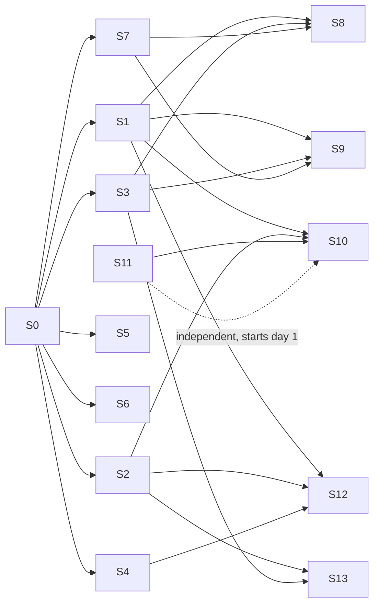

# 7. Delivery plan, parallelisation, conventions

## 7.1 Principle: contracts first, then independent streams

Week 1 (S0) produces `packages/contracts` (schemas, OpenAPI, generated types) and the adapter `Fake*`s. From there, **thirteen streams** move forward in parallel; each depends on the others only through the contracts and is tested against the fakes. Integration happens continuously through the merge queue and through milestones M1–M5, where an end-to-end scenario must pass on kind.

## 7.2 Streams

| Stream | Scope | Exit deliverable | Depends on | Sections |
| :-- | :-- | :-- | :-- | :-- |
| **S0 Contracts & foundation** | `packages/contracts`, `packages/core` (DSL parse/validate, policy engine, model resolution), fakes, monorepo CI, `dev/` (kind + Tilt), `AGENTS.md` | Generated Python/TS types; `choregos workflow validate`; `make dev-up` green | — | 1, 6.9 |
| **S1 Orchestrator** | `apps/orchestrator`: `WorkflowInterpreter`, activities, human wait, gates, migration, `ProjectProvisioning` skeleton, tests with the Temporal `WorkflowEnvironment` | A simulated ticket goes through `default-simple` with fakes | S0 | 2.1 |
| **S2 Runner & agents** | `packages/runner` (ACP client, guardrails, DoD loop, result), `packages/tools-mcp`, runner image, backends (OpenHands first), Tekton + K8s Job `Executor`, Tekton `Task`, backend conformance suite | A `PipelineRun` runs an OpenHands stage on a toy repository and posts a valid `StageResult` | S0 | 2.2–2.4 |
| **S3 GitHub connectors** | GitHub Issues + Projects v2 tracker, GitHub App SCM, webhooks, status comment, board fields, merge queue, `scope`/`evidence` check-runs | A moved card → `InboundEvent`; cost comment rewritten; PR opened/merged by the App | S0 | 3.1 |
| **S4 Gateway & costs** | LiteLLM deployment (chart, config), `GatewayAdapter` (mint/spend/revoke), `cost_ledger`, aggregates, estimation, `GET /costs`, Claude Code compatibility matrix (headers) | Exact cost per run visible in the database and through the API | S0 | 4.1–4.3 |
| **S5 Front end** | `apps/web`: all pages against the mock API (Prism) then the real one; workflow editor; SSE | Wizard → board → run → trains → findings → memory usable | S0 (OpenAPI) | 3.4 |
| **S6 API** | `apps/api`: REST, OIDC auth, RLS, webhooks (normalisation → Temporal), internal, SSE, audit | Postman/Schemathesis 100% of OpenAPI; signed GitHub/Tekton/Argo webhooks | S0 | 1.8, 3.5 |
| **S7 K8s platform** | `charts/choregos`, `choregos-infra` (bootstrap, platform, projects ApplicationSet, Kyverno policies), dev/staging/prod environments, backups, observability, egress proxy | `argocd app sync` deploys the complete platform in staging from Git | S0 | 6 |
| **S8 Templates & provisioning** | `templates/github-tekton-argo-k8s` (manifest, Tekton CI, Argo apps, scaffold), `ProjectProvisioning` activities, template tests | A project created from the wizard gets its scaffolding PR and its namespaces through Argo | S1, S3, S7 | 3.2–3.3 |
| **S9 Release train & GitOps** | `ReleaseTrain`, Argo `CdAdapter`, GitOps layout, Rollouts + `AnalysisTemplate`, smoke Jobs, Atlantis, Trains page (with S5) | Two merges → one batch; broken canary → rollback + freeze | S1, S3, S7 | 5.1–5.3 |
| **S10 Findings & memory (Choregos side)** | `FindingsTriage`, Ecphoria + pgvector `MemoryAdapter`, `MemoryIngestion`, `build_context_pack`, memory MCP, Findings/Memory page (with S5) | Deduplicated finding → linked ticket; context pack injected and traced | S1, S2, S11 (E-05/E-06) | 4.4, 5.4 |
| **S11 Ecphoria** | In `VargaFoundation/ecphoria`: E-01 → E-14 | `ecphoria:memory` image with `context-pack`, upsert, pending, hardened chart | — (starts day 1) | 4.4 |
| **S12 Evals & conformance** | `EvalMatrix`, playbook evals, template conformance suite, nightly e2e, toy repositories | Backend × model matrix published; e2e green every night | S1, S2, S4 | 2.5, 4.2 |
| **S13 Multi-backend & second ecosystem** | Claude Code / Codex / Gemini / Goose / OpenCode backends (launch specs + conformance), cross review, Jira/GitLab adapters, `azure-devops-aca` or `gitlab-ci-argo-k8s` template, ACA `Executor` | Review by an agent ≠ implementer; a Jira/GitLab project follows the same workflow | S2, S3 | 2.2, 3.1 |

Dependency graph:



## 7.3 Integration milestones

| Milestone | Week | Scenario that must pass on kind (`tests/e2e`) |
| :-- | :-- | :-- |
| **M0 Contracts frozen** | 1 | Generated types, fakes, `make dev-up`; all sessions can start |
| **M1 Vertical slice** | 3 | GitHub issue labelled `agent-ready` → `WorkflowInterpreter` (`default-simple`) → OpenHands `PipelineRun` → green PR → per-stage cost comment in the issue → provoked finding → linked issue |
| **M2 DSL + front end** | 6 | The three workflow templates; human approval by moving a card; wizard creates a project (CD fakes); live board and runs; cost estimation |
| **M3 Controlled prod** | 9 | Real provisioning (Argo); two merged tickets leave in the same batch; broken canary → rollback → freeze; the platform itself is deployed to staging by Argo |
| **M4 Multi-backend & memory** | 12 | Cross review Claude Code ↔ OpenHands; Ecphoria context pack in the stages; memory A/B launched; eval matrix published; model change per project without redeployment |
| **M5 Hardened** | 16 | gVisor, egress proxy, rotation, chaos (kill worker / PipelineRun → resume without loss or double cost), tested backup/restore, second ecosystem (Jira or GitLab), docs, runbooks |

## 7.4 Sprints (2 weeks) and session assignment

Assumption: 1 integrator human + N Claude Code sessions in parallel (one per active stream). One session = one worktree = one branch `stream/<Sx>/<story>`. The table gives the priority order of the stories (see `08-backlog.yaml`, `sprint` field).

| Sprint | Active streams | Goal |
| :-- | :-- | :-- |
| 0 (wk 1) | S0, S11 (E-01) | M0; triage of the Ecphoria PRs |
| 1 (wk 2–3) | S1, S2, S3, S4, S6, S7 (dev+staging), S11 (E-02, E-06, E-08) | M1 |
| 2 (wk 4–6) | S1 (full DSL), S5, S6, S8, S12 (conformance), S11 (E-03, E-04, E-05) | M2 |
| 3 (wk 7–9) | S7 (prod), S8, S9, S5 (trains), S10 (findings), S11 (E-07, E-10, E-11) | M3 |
| 4 (wk 10–12) | S10 (memory), S12 (evals), S13 (backends), S4 (matrix), S11 (E-09, E-12) | M4 |
| 5 (wk 13–16) | S7 (hardening), S13 (Jira/GitLab, ACA), S12 (chaos), S11 (E-13, E-14), docs | M5 |

## 7.5 Claude Code operating mode (or any ACP agent)

1. **One session per stream**, in a dedicated worktree: `git worktree add ../choregos-S3 -b stream/S3 && cd ../choregos-S3 && claude`. Opening prompt: "Read `docs/plan/00-index.md`, `docs/plan/01-architecture-and-contracts.md` and the section of your stream (*Sections* column of table 7.2). Take the `stream: S3` stories of `docs/plan/08-backlog.yaml` in `sprint`, `priority` order. For each story: plan (plan mode), implementation, tests, a separate PR titled `[S3-04] …`, tick the `acceptance` in the description. Do not modify `packages/contracts`: if a contract is missing, open a `contract-change` issue and continue with a local workaround marked `TODO(contract)`."
2. **Integrator session** (human + Claude): reviews the PRs, runs `make ci`, merges through the merge queue, updates `docs/plan/STATUS.md` (stories → state table), settles the `contract-change`s, runs the milestone e2es.
3. **PR conventions**: one story = one PR; description = template (section 7.7); the body cites the ticked acceptance criteria; green CI mandatory; no force-push on `main`.
4. **When a session is blocked**: it writes `docs/plan/BLOCKERS.md` (stream, story, cause, proposed workaround) and moves on to the next non-dependent story.
5. **Sub-agents**: allowed for exploration and reviews; writing stays in the stream's worktree.
6. **Dogfooding**: from M1, the `choregos` monorepo is the first Choregos project (`template github-tekton-argo-k8s`, workflow `default-simple`); the stories of sprints 3+ go through the platform.

## 7.6 The monorepo's `AGENTS.md` (copy to the root; `CLAUDE.md` → symbolic link)

```markdown
# Choregos — instructions for agents

## Context
Agentic delivery platform (Varga Foundation, Apache 2.0). Full plan: `docs/plan/`. Contracts: `packages/contracts` (do not modify without a `contract-change` PR).

## Commands
- Everything: `make ci` (lint + typecheck + unit tests) · `make dev-up` / `make dev-down` (kind + Tilt) · `make e2e`
- Python (uv) : `uv run ruff check . && uv run ruff format --check . && uv run mypy packages apps && uv run pytest -q`
- Web : `pnpm -C apps/web lint && pnpm -C apps/web typecheck && pnpm -C apps/web test && pnpm -C apps/web build`
- Charts : `helm lint charts/choregos && helm template charts/choregos | kubeconform -strict`
- Contracts: `make contracts` (regenerates the types; commit the result)

## Conventions
- Python 3.12, strict typing (`mypy --strict` on `packages/*`), pydantic v2, async on all I/O, structlog. Strict TypeScript, ESLint, Prettier.
- Conventional commits: `feat(orchestrator): …`, `fix(runner): …`, `contract(schemas): …`. One story = one PR = one squash.
- Tests: unit tests mandatory; integration with fakes (`CHOREGOS_FAKES=1`); e2e on kind for the milestones. Coverage ≥ 80% on `packages/core`, `packages/runner`, `apps/orchestrator`.
- Idempotence: every Temporal activity and every provisioning step can be replayed without a double effect.
- Security: no hard-coded secret; never a broad token in a runner; every tracker write goes through the internal API.
- Logs: JSON, keys `project`, `work_item`, `run_id`, `stage` when available.

## Definition of done (blocking)
Green tests (`make ci`), green typing, green lint, docs up to date (`docs/` or docstrings), the story's acceptance criteria ticked in the PR, no `TODO` without a linked issue, `docs/plan/STATUS.md` updated by the integrator.

## Out of scope
If you discover a problem outside your story: do not touch it, open a `finding` issue with `origin: <story>`, evidence and a proposal. If you need a contract: a `contract-change` issue.

## Memory
Architecture decisions are in `docs/plan/` and `docs/adr/`. Read them before deciding; add an ADR (`docs/adr/NNNN-*.md`) for any structural decision.
```

## 7.7 PR template (`.github/PULL_REQUEST_TEMPLATE.md`)

```markdown
## Story
`[Sx-NN] title` — link `docs/plan/08-backlog.yaml`
## Change
…
## Acceptance criteria
- [ ] …
## Proof
Commands run, test results, screenshots if front end
## Contracts
- [ ] No change in `packages/contracts` (otherwise a linked `contract-change` PR: #…)
## Findings filed
- #…
```

## 7.8 Monorepo CI (`.github/workflows`, then Tekton from M3)

`ci.yml` (PR): detection of the changed paths → targeted jobs: `python` (ruff, mypy, pytest per package), `web` (lint, typecheck, vitest, build), `charts` (lint, kubeconform, Helm unittest), `contracts` (schema validation, generation, empty diff), `images` (multi-arch build, Trivy, cosign sign on `main`), `conformance-backends` (ephemeral kind, OpenHands only on PRs; all backends at night), `templates` (provisioning on kind, nightly). `release.yml`: semver tag → images, OCI charts, changelog (release-please). `nightly.yml`: full e2e, `EvalMatrix`, Temporal replay, dependency scan.

## 7.9 Risks

| Risk | Mitigation |
| :-- | :-- |
| Contract drift between streams | Freeze at M0, single `contract-change` PRs, generated types, contract tests (Schemathesis, Pact-like on `StageInput/Result`) |
| Young ACP; uneven adapters | Conformance suite per backend in CI; native OpenHands as fallback; backends disabled automatically |
| An agent bypasses the permissions | Guarantee = diff check + gate + sandbox, not the permission |
| Token costs | Key per run with a hard cap; ticket budget; 80% alerts; `cheap` for triage/dedup; cache enabled |
| Immature Ecphoria | Memory scope only; pgvector fallback with the same interface; A/B before dependency |
| Poorly versioned Temporal | `patched()` mandatory; replay in CI; `numHistoryShards` fixed |
| Tekton: moving governance | K8s Job `Executor` ready; simple Task, few advanced features |
| Conflicts between parallel sessions | Worktrees, disjoint scopes per stream, merge queue, fakes |
| Over-engineering | Each sprint delivers a usable e2e scenario; nothing "phase 6" before M3 |

## 7.10 Day-0 checklist (human)

1. Create `VargaFoundation/choregos` and `VargaFoundation/choregos-infra` (Apache 2.0), enable merge queue, branch protection, Dependabot/Renovate.
2. Reserve the name (section 0.2): domains, package orgs, PyPI/npm.
3. Provider accounts: Anthropic Console (`choregos` workspace, keys, cap), OpenAI/Google/Foundry depending on the choice; LiteLLM `master_key`.
4. Cluster: AKS or GKE (1.31+), `system`/`platform`/`runners` (spot) pools, gVisor on `runners`, DNS `*.choregos.<domain>`, versioned bucket, Key Vault / Secret Manager.
5. GitHub App `choregos-bot` (permissions in section 3.1) and App `choregos-infra-writer` (Contents RW on `choregos-infra`).
6. OIDC IdP (Entra ID / Google / Keycloak): client `choregos`, groups `product-owners`, `release-captains`, `developers`.
7. Slack: app, `#choregos` channel.
8. Copy `docs/plan/`, `AGENTS.md`, start S0.
