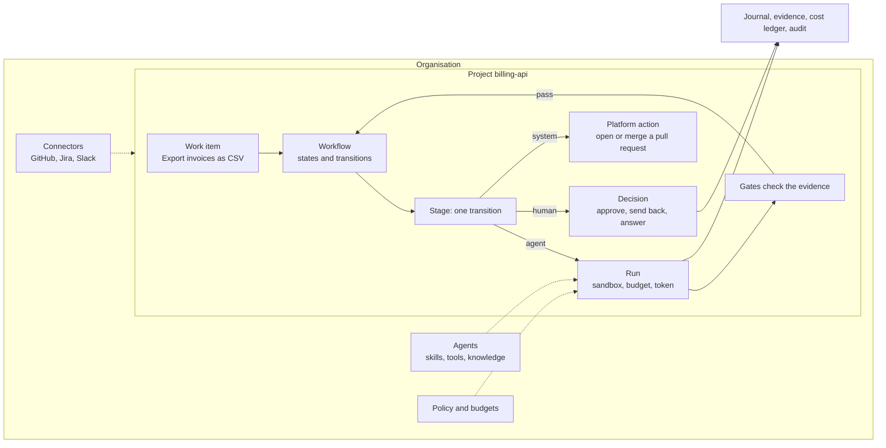

# Concepts

This page explains the ideas behind every screen of Choregos. Read it once before your first
project; come back to it when a word in the console is unclear.

**What you will be able to do**

- Name the objects you meet in the console and say what each one is for.
- Tell who acts at each step of a workflow: an agent, a person or the platform.
- Know what protects a run, what it costs, and where its trace is kept.

## The big picture

A **work item** enters a **project**. The project's **workflow** says which step comes next and who
does it. An agent step is a **run**, checked by **gates**. A person's step is a **decision**. Everything
lands in the journal and the cost ledger.

## Organisation

The organisation is your company or team on a Choregos instance. It holds the projects, the people,
the agents, the skills, the knowledge bases and the connectors that projects share. An organisation
administrator manages it under **Admin**.

The community edition holds one organisation per instance. See [Editions](#editions).

## Project

A project is one stream of work with its own workflows, members, connectors, policy and budgets: a
repository a team develops (`billing-api`), or a business process with no code at all (an employee
onboarding). A project is often born from a **template**, which brings its workflows, its policy and
the agents those workflows name, and sets up the outside systems (labels, a board, webhooks).

A project tells you what it still lacks to run: its **readiness** list, on the first page of its
**Settings**, says what is missing and who can fix it.

## Members and roles

A person belongs to the organisation with a role, and may have a role on a project too. A project role
**adds** to the organisation role; it never takes anything away.

| Role | What it adds |
| :-- | :-- |
| **Viewer** | Read the project: its board, work items, runs and costs |
| **Developer** | Decide the human steps addressed to them, pause, resume, stop or replay work, triage findings, keep personal agents |
| **Release captain** | What a developer does, plus operate release trains and approve a production departure |
| **Project owner** | What a developer does, plus change the project: its settings, connectors, workflows, policy, models, members, its own agents and knowledge bases |
| **Organisation admin** | Everything, in every project: create projects, manage organisation agents, skills, connectors, models, the network and the audit log |

People also carry **groups** from your identity provider (for example `maintainers` or
`product-owners`). A workflow addresses a human step to a group; only a member of that group (or an
organisation administrator, and that override is audited) may answer it.

## Workflow

A workflow is the process a project follows, written as a state machine in YAML:

- **States** are the columns of the board: "To triage", "Specification to approve", "Merged". A state
  of kind `wait` waits for a person. A `terminal` state ends the work item.
- **Transitions** move a work item from one state to the next. Each transition names **who acts**
  (`by`), what it reads and produces (`inputs`, `outputs`), the **gates** that must pass, and what
  happens when it fails (`on_fail`: retry a few times, then escalate to a person).

Who acts on a transition:

| Actor | What it is |
| :-- | :-- |
| `agent` | An agent from the registry does the step, in a sandbox, under a budget |
| `human` | A person of a group decides: approve, send back, answer, or complete a task |
| `system` | The platform does it itself, at no model cost: open the pull request, merge it, open child work items |
| `job` | A fixed command runs in the sandbox, with no model: a backtest, a conversion |
| `decision` | A small model answers typed questions (finished? which team?) to choose the next step |

A workflow is **validated when it is written**, not when a work item is halfway through it: an
unreachable state, a retry that could loop forever or a gate with nothing to check is refused at once.
A workflow is **versioned**: publishing a change creates the next version, and a work item already in
progress finishes on the version it started with. A project may have several workflows; **routing**
rules (by label, by type) choose one for each incoming work item.

## Work item

A work item is one request: an issue on GitHub or GitLab, a Jira ticket, or a request filed in Choregos
itself. It is pinned to one version of one workflow when it starts. Its page shows where it is, what
it waits for, its journey, its cost per stage and what each step produced (its **artifacts**: a
specification, a report, a deck).

## Stage and run

A **stage** is one transition being carried out. When an agent carries it, the stage is a **run**:

- one disposable sandbox and one workspace (a clone of the repository when the agent needs one);
- one short-lived token, valid for that run only;
- one model key, capped at what is left of the budget;
- only the tools, knowledge and network the agent and its project allow.

The runner talks to the agent, records every message in the run's **journal**, applies the guard rails
(allowed paths, forbidden commands, network), and hands the result to the gates. A run that is played
again does not pay twice and does not act twice.

## Gates

A gate is a check the platform runs on what a step produced. It is code, not an instruction to the
agent. A few examples:

| Gate | Passes when |
| :-- | :-- |
| `evidence_present` | the tests were actually run by the platform, not just reported |
| `scope_respected` | the diff stays inside the paths the work item allows |
| `no_secrets` | the change writes no secret |
| `outputs_present` | the step produced every output the transition declares |
| `ci_green` | the pull request's checks are green |
| `docs_updated` | a change to the code also changes the documentation |

**A gate that cannot see what it must check refuses.** A guarantee that passes blindly is worse than
none. The [workflow reference](../concepts.md#gate) lists every gate.

## Agents

An agent is a registered, versioned object of the organisation: its instructions, the model it uses,
its skills, its tools, the knowledge it reads, its limits. Each change publishes a new **version**; a
project runs the version its **production** channel points to, and a new version can be tried on a
**testing** channel first.

An agent has an **owner**: the common catalogue (installed with the platform), the organisation, one
project, or one person. A **personal** agent never runs in a workflow: a process the whole team relies
on must not depend on an agent one person can change or take away.

Agents come in several kinds:

| Kind | What it is |
| :-- | :-- |
| Coding agent | A coding agent the runner ships (Claude Code, OpenCode, Gemini CLI and others), working in the workspace |
| Prompt agent | Instructions, a model, tools and knowledge, with no coding agent: the platform runs the tool loop |
| Voice agent | The same, spoken: a realtime model and a voice, used in sessions, never as a workflow step |
| Hosted agent | Your own container, following a standard contract |
| Code agent | An agent written in code (LangGraph, the OpenAI Agents SDK, plain Python), in an image built from the runner's |
| Remote agent | An agent elsewhere, called over A2A (for example Atlassian Rovo), under the same gates and budget |

See [Agents](build/agents.md) for how to create them.

## Skills

A skill is a folder of know-how an agent loads: how to write a decision record, how your team names
branches, the checklist of a security review. Skills are a library of the organisation, versioned like
agents. **A skill grants no permission**: what an agent may call is decided by its version and its
project, never by a file it reads. See [Skills](build/skills.md).

## Tools and MCP servers

An agent's own tools are those of its coding agent (read a file, run a command). On top of them, the
platform offers:

- **its own tools**, always there: report a finding outside the agent's scope, ask a person a question,
  request a wider scope;
- **catalogue tools**: a short list of third-party APIs and **MCP servers** the organisation chose.
  The platform calls them on the agent's behalf: the agent never holds the credential, never chooses
  the address and never sees the remote tool's real name. A tool the agent may not use answers "not
  found", like a tool that does not exist.

An agent version names the tools it uses; its project can only narrow that list, never widen it. See
[Tools](build/tools.md).

## Knowledge bases and memory

A **knowledge base** is a set of documents a person curates and agents only read: an architecture
framework, policies, runbooks, a product's documentation. Its documents are uploaded or synced from
Confluence, SharePoint, a git repository or a web site, and converted to text. Its **reach** says which
projects' runs are served it; its **grants** say who may change it. See [Knowledge](use/knowledge.md).

**Memory** is different: what agents learn from work, proposed by runs and accepted by people.

## Connectors

A connector is how Choregos talks to an outside system: the **tracker** where requests live (GitHub
Issues, Jira, GitLab, or Choregos itself), the **repository** (GitHub), the **deployment** (Argo CD),
**notifications** (Slack, e-mail), documents, an identity directory. A **connector type** is an entry
of the catalogue; a **connector** is one the organisation or a project has installed and configured.
A project needs only what its workflows read, and its settings say which ones. See
[Connectors](use/connectors.md).

## Human decisions

A workflow names the points where a person decides. Choregos never guesses past them:

- an **approval**: approve, or send back with a reason;
- a **question** an agent asked: answer it, and the work resumes where it stopped;
- a **task** a person does in the real world: fill in a form, attest it was done;
- a **governed action**: a write into another system (create an account, order a laptop), proposed
  by an agent or a workflow and run by the platform only after the people it names approve.

Every human step has a deadline and an escalation. What waits for you is in the **Inbox**. See
[Decisions](use/decisions.md).

## Evidence, journal and audit

Choregos keeps three kinds of trace:

- **Evidence**: what a step measured and left behind: tests run and passed, lint, coverage, diff size,
  and the business **facts** a workflow names. Gates read it; the run page shows it, marked as
  observed by the platform or declared by the agent.
- **The journal** of each run: every message between the runner and the agent, what it read, wrote and
  ran, what it reached on the network, and what was refused.
- **The audit log** of the organisation (**Admin › Audit**): who changed a setting, approved a
  decision, granted a budget top-up, overrode a group.

## Budgets and policies

Every model call is made with a key capped for that run, and lands in a **cost ledger** with its
project, work item, stage and model. A run's key is minted at what is **left**: of its stage budget,
its work item's budget, its project's day and its organisation's month. When the money is spent, the
run stops and a person decides; a stage stopped on budget is never retried on its own.

A project's **policy** bounds what its agents may do: budgets by work item size, the paths no run may
write, forbidden commands, the hosts a run may reach, release trains. An organisation sets a
**ceiling** that every project policy can only tighten. See
[Budgets and policies](use/budgets-and-policies.md).

## Tokens and applications

- A **personal access token** lets you use the API and the command line as yourself. You create it
  under **My account › Access tokens**. Its **scope** limits what it opens: `*` (the API and the CLI),
  `mcp:read` or `mcp:write` (an AI assistant at the MCP door), or `a2a` (the A2A door). An MCP or A2A
  token can be limited to one project. A token is shown once, expires, and can be revoked.
- An **application** (a machine account) is how another system calls Choregos under its own name, not
  a person's. It belongs to one project (**Settings › People › Applications**), has its own daily
  budget, and outlives the person who created it. An application starts work; it never takes a
  decision.

## Editions

- The **community edition** is Apache 2.0 and holds one organisation per instance. Everything in this
  documentation is in it.
- The **enterprise edition** is published separately. It adds several organisations on one instance,
  with the isolation and the identity features they need.

**Admin › Edition** and **About** (at the bottom of the sidebar) say which one runs.

## Go further

- [Get started](get-started.md): try it, then run a first project.
- [Concepts in depth](../concepts.md), the reference page these concepts come from.
- [Where Choregos sits](../positioning.md) against other agent platforms, runtimes and tool brokers.
